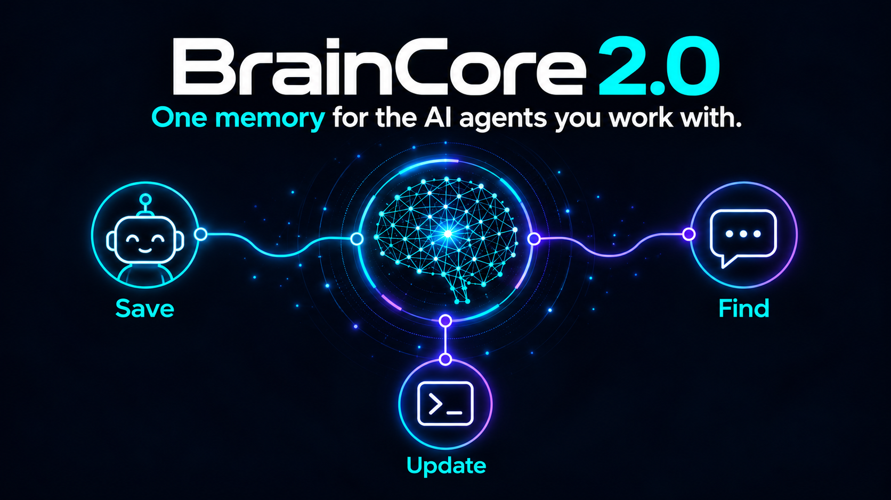
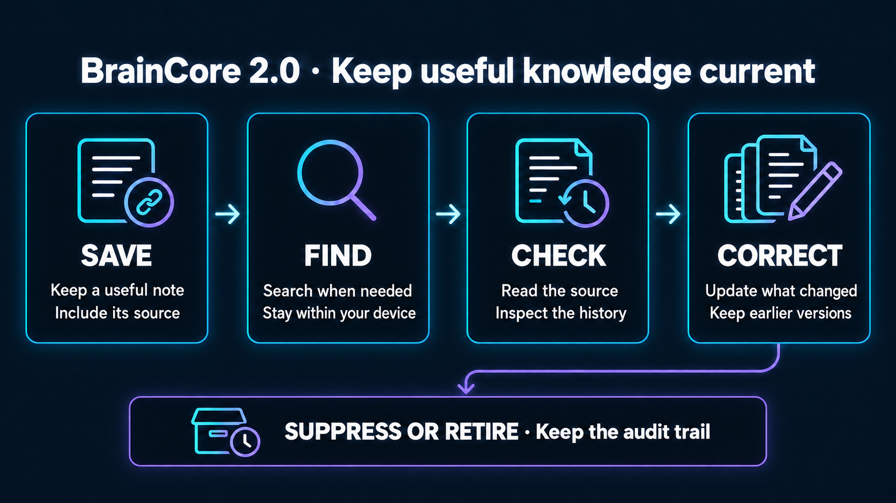
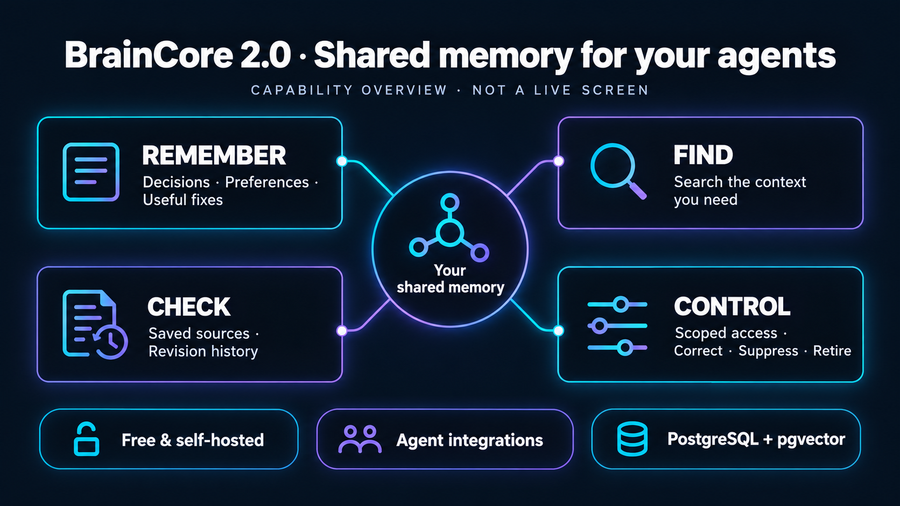
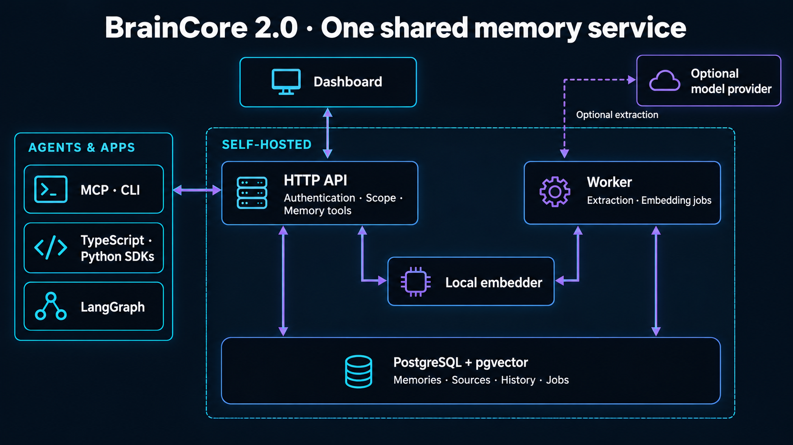
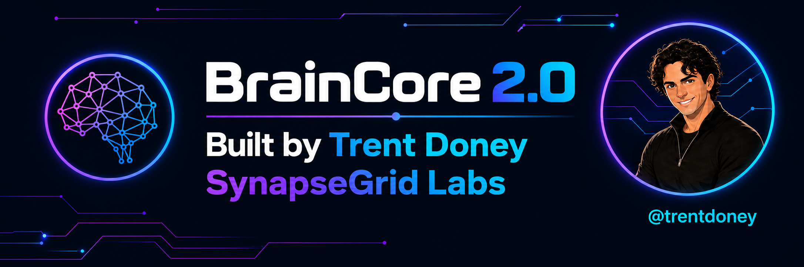

# BrainCore 2.0

**One memory for the AI agents you work with.**

Keep your project decisions, preferences, and useful fixes close at hand as you
move between agents, conversations, and tasks. BrainCore gives your connected
agents a shared place to save that knowledge and find it again when they need it.



BrainCore is free and self-hosted. You run it yourself and choose what each agent
can access. You can check saved sources, correct information when things change,
and see the history of those updates.

## A simple example

Your agent saves a weekly report in the wrong folder. You find the fix:
"Use the Reports folder."

1. **Save it.** Store that instruction with a note about where it came from.
2. **Find it later.** In a new session, your agent searches for where to save
   weekly reports.
3. **Check the source.** Read the saved note before using the instruction.
4. **Keep it current.** If the folder changes to "Team Reports", correct the
   memory. Its earlier version stays in the history.

BrainCore provides the memory tools; your agent or application decides when to
save, search, and use a result.



In the default local setup, memory and search run on your computer. You can also
host BrainCore on your own server; optional model providers are configured
separately.

You can also suppress or retire a memory without erasing its audit history.
These are tools you or your connected agent choose to use.

## What you can do

- **Remember:** save instructions, decisions, and useful fixes.
- **Find:** look up the context you need instead of starting from scratch.
- **Check:** see the saved source behind a result.
- **Correct:** update a memory while keeping its earlier version.
- **Share carefully:** give each agent or app access to the information it needs.



This is a conceptual overview, not a live application screen. BrainCore gives
connected agents memory tools; their instructions or your application decide
when to use them.

## Source installation (2.0.0 candidate)

This candidate is distributed as source. npm, PyPI, and container registry
artifacts for version 2.0.0 are not part of this source publication; do not use
registry install commands for this version. Build the application image locally.

Requirements: Docker with Compose, Bun 1.2+ for source builds, Python 3.11+
and uv for Python tooling, and sufficient disk space for image builds and the
database. The built TypeScript SDK and MCP server target Node.js 20.19+.
The container uses Python 3.14 and Bun 1.4.3. CI also uses Bun 1.4.3.
Avoid Bun 1.3.7 and 1.3.8 because of an [upstream startup hang](https://github.com/oven-sh/bun/issues/26810).

From a source checkout:

```bash
uv sync --frozen --extra dev --extra langgraph
bun install --frozen-lockfile
bun run build
bun dist/cli.js up
```

The command creates `.braincore/.env` with mode `0600`, generates credentials,
starts PostgreSQL, migrations, the resumable lexical backfill, the local
384-dimensional embedder, worker, API,
and dashboard, then waits for readiness. Open <http://127.0.0.1:8787> and use
the bootstrap API key printed on first start.

Verify a complete evidence round trip:

```bash
bun dist/cli.js remember "The release window is Friday" --project demo
bun dist/cli.js search "release window" --project demo
bun dist/cli.js doctor
```

A source checkout makes `up` use `compose.yaml` with `compose.dev.yaml` and
build the image locally. Keep the source checkout while using CLI backup/restore.
The standalone Compose file defaults to the local image `braincore:2.0.0-full`;
`BRAINCORE_IMAGE` can select a separately verified image. A packaged CLI has no
Dockerfile and cannot build the image. Use its SDK/client commands only after
preparing an image locally or connecting to an existing verified server.
Build time depends on the host and network; no startup-time guarantee is made.
A public domain is optional; use a TLS reverse proxy when making the service
available beyond the local host. See [source SDK installation](examples/README.md).

## Connect your agents and apps

Use the HTTP API, SDKs, or an integration to have your agent save and search
memories. Connecting an agent gives it tools; configure its instructions or your
application to call them when useful.

- [HTTP API and error contract](docs/api.md)
- [TypeScript, Python, and curl examples](examples/README.md)
- [MCP integration](docs/integrations/mcp.md)
- [Codex integration](docs/integrations/codex.md)
- [Claude Code integration](docs/integrations/claude.md)
- [LangGraph integration](docs/integrations/langgraph.md)
- [Operations, backup, restore, upgrade, and rollback](docs/operations.md)
- [Benchmark methodology](benchmarks/README.md)
- Authenticated runtime OpenAPI: `http://127.0.0.1:8787/docs`

## How it works

BrainCore stores a memory together with its source and history, called
**provenance**. After searching, you can inspect a result's saved source and
history to check what the memory is based on and how it has changed.

- **Separate access:** tenants are isolated. Within a tenant, project, user,
  agent, and run scopes limit what a key can read or change.
- **History you can inspect:** corrections create revisions. Suppression and
  retirement keep an audit trail and can be reversed.
- **Visible failures:** batch, extraction, and embedding failures remain visible
  and retryable. Search reports when a retrieval stream is degraded.
- **One store:** PostgreSQL with pgvector is the canonical database. Redis is
  not required.
- **Consistent interfaces:** the HTTP API, dashboard, TypeScript/Python SDKs,
  MCP server, and LangGraph store use the same server-side rules.

Saving a memory directly and searching do not require a cloud account or a
hosted control plane. Optional text extraction can use a separately configured
model provider; review that provider's data handling before sending content to
it. See [deployment configuration](docs/operations.md#local-and-shared-deployment).



The dashboard and integrations use the HTTP API. PostgreSQL with pgvector is the
canonical store, the worker handles background jobs, and the local embedder
supplies vectors. Optional text extraction can use a separately configured
model provider.

## Security and access

BrainCore binds to `127.0.0.1` by default. API keys are 256-bit, shown once,
stored as prefix plus digest, tenant-bound, role-scoped, revocable, rotatable,
and audited. Every non-admin key is bound to a project/user/agent/run scope;
admin keys are explicitly tenant-wide. The dashboard exchanges a key for a same-origin HttpOnly session
cookie and does not retain the key in browser storage. There is no general
memory `DELETE` endpoint.

See [SECURITY.md](SECURITY.md) before exposing the service to a network.

## Upgrading from 1.x

BrainCore 2.0 is a clean, breaking platform replacement. It does not
automatically migrate or read the 1.x `preserve` schema. Use a separate
database and follow the [1.x migration boundary](docs/operations.md#moving-from-braincore-1x)
before changing an existing deployment.

## Development

See [CONTRIBUTING.md](CONTRIBUTING.md) for contribution and verification guidance.

```bash
uv sync --frozen --extra dev --extra langgraph
bun install --frozen-lockfile
bun run generate:openapi
bun run build
uv run ruff format --check .
uv run ruff check .
uv run mypy src benchmarks
uv run pytest -q
bun run typecheck
bun test
./scripts/test-e2e.sh
./scripts/test-compose-e2e.sh
```

Public benchmark results are accepted only when every declared case completes
and the exact dataset, model, prompt, hardware, raw outputs, and hashes are
retained. No comparative superiority claim is made by this repository.

## License

MIT. See [LICENSE](LICENSE) and [third-party notices](THIRD_PARTY_NOTICES.md).

## Built by Trent Doney

BrainCore is built by [Trent Doney](https://github.com/trentdoney) at
[SynapseGrid Labs](https://github.com/SynapseGrid-Labs).


